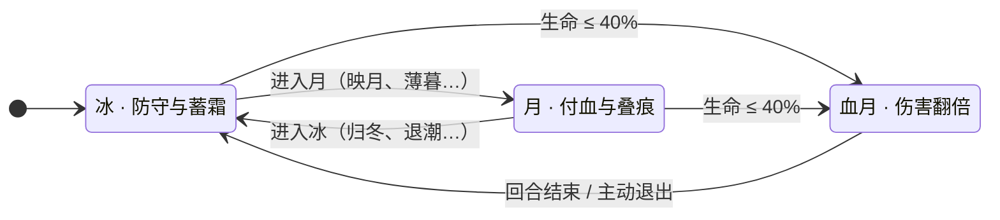
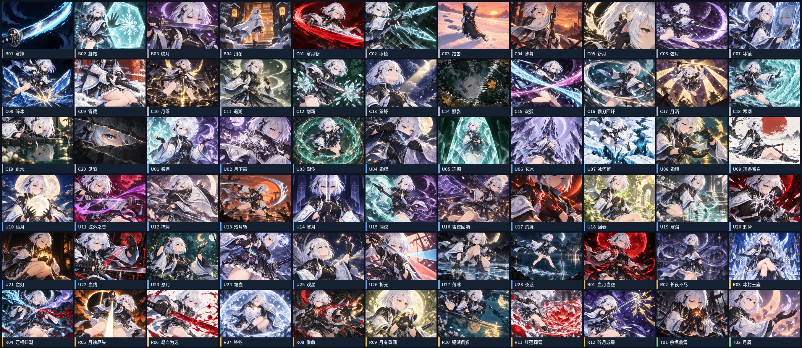
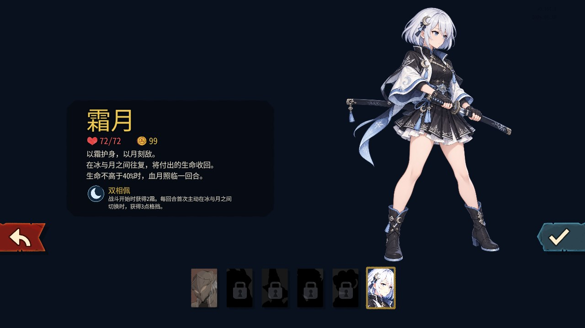
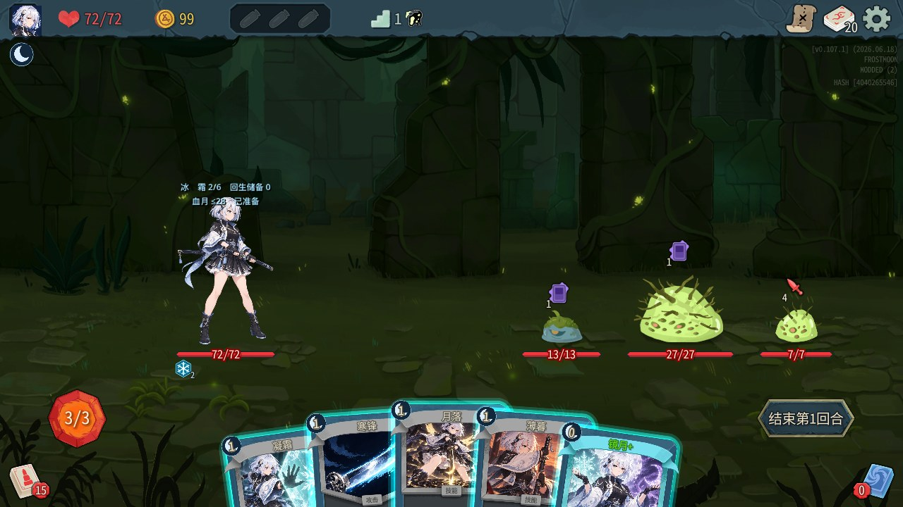
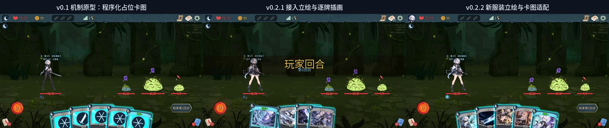

# 小木曾和纱 · 冰月绘卷

《杀戮尖塔 2》原创角色 Mod。一名在**冰**与**月**两种形态间往复、以生命为代价换取力量的太刀剑士；生命跌破 40% 时，**血月**照临一回合。


| 版本 | 适配游戏 | 卡池 | 实机验证 | 内部 ID |
|---|---|---|---|---|
| v0.2.3 | 《杀戮尖塔 2》v0.107.1 | 64 张主卡 + 2 张衍生牌，全部独立插画 | macOS Apple Silicon 单人，165 项自动化检查通过 | `Frostmoon` |

**目录**：[核心机制](#核心机制) · [卡牌设计](#卡牌设计) · [游戏内实战](#游戏内实战) · [设计迭代](#设计迭代) · [技术实现](#技术实现) · [仓库结构](#仓库结构) · [安装与构建](#安装与构建)

---

## 核心机制

角色以 72 生命、3 能量开局，初始遗物「双相佩」：战斗开始时获得 2 霜；每回合首次在冰与月之间实际切换时，获得 3 格挡。



| 形态 | 被动 | 设计意图 |
|---|---|---|
| **冰** | 每回合前 2 张在冰开始结算的技能各得 1 霜；本回合首次在冰触发月蚀后回生 2 | 安全形态：攒资源、收回付出的生命 |
| **月** | 每回合前 2 张在月开始结算的单体攻击额外支付 1 生命，附加 1 月痕；若改付 1 霜则附加 2 | 进攻形态：以生命和霜加速叠痕 |
| **血月** | 攻击与月蚀伤害翻倍；不额外给能量或抽牌 | 高风险窗口：把低血量变成爆发回合 |

**三种资源**

| 资源 | 规则 |
|---|---|
|  **霜** | 玩家资源，默认上限 6。冰的技能产出，卡牌可消耗换取伤害、格挡或抽牌 |
|  **月痕** | 叠在每个敌人身上，每层点亮月盘 1/8。满 8 层扣去 8 并触发**月蚀**：4 次 4 点效果伤害，保留溢出层数 |
| **回生储备** | 主动支付的生命计入储备，「回生」只能收回这部分，不能抹掉敌人造成的伤害——自损是可回收的投资，而不是免费的燃料 |

**血月的节奏约束**：血月当回合结束回到冰；下个回合抽牌后获得衍生牌「余烬覆雪」（保留、格挡、回生）作为恢复补偿；之后一整个自身回合不能再次触发，必须在血月外恢复到至少 55% 生命才能重新准备。这组规则让血月成为需要规划的窗口，而不是可以反复卡血线的永久状态。

---

## 卡牌设计

### 卡池结构

卡池分工参考了对一个成熟角色 Mod 共 93 个卡牌类的源码研究（见[设计迭代](#设计迭代)）：**基础牌进入资源循环，罕见牌把已有行为连起来，稀有牌改变资源的用途或约束。**

| 稀有度 | 攻击 | 技能 | 能力 | 合计 | 职责 |
|---|---:|---:|---:|---:|---|
| 初始 | 2 | 2 | – | 4 | 基础攻防 + 冰／月入口各一张 |
| 普通 | 8 | 12 | – | 20 | 形态入口、低费叠痕、霜的基础兑现 |
| 罕见 | 6 | 16 | 6 | 28 | 跨资源桥梁、切换回报、付血回报 |
| 稀有 | 3 | 4 | 5 | 12 | 构筑支点：改变月蚀段数、保留格挡、切换引擎 |
| 衍生 | – | 2 | – | 2 | 余烬覆雪（血月后恢复）、月屑（悬月生成） |

### 四条构筑路线

| 路线 | 核心循环 | 测试牌组 |
|---|---|---|
| **冰月往复**（切换） | 冰蓄霜 → 薄暮或映月进月 → 弦月等加速叠痕 → 月落引爆 → 归冬或退潮回冰 | 主推样例，无需低血量 |
| **极霜守夜**（控霜） | 维持 4–6 霜；冻彻防守、玄冰施加虚弱；有斩杀机会才用冰河断或碎冰花掉库存 | 验证持有与消费霜的取舍 |
| **月蚀潮汐**（月蚀） | 布置月下霜、潮汐后，以新月、弦月、满月反复凑满 8 层 | 验证多段效果与群体标记 |
| **血月回潮**（血月） | 接近 40% 时用血线选档或灼脉调血，把攻击和寒浴留给血月；下回合用余烬覆雪恢复 | 验证可控付血与再次蓄势 |

### 代表卡牌

每条路线选两张：一张普通或罕见的「循环件」，一张改变玩法的「支点」。数值为游戏内运行版本（升级值见括号）。

| | 卡牌 | 效果 | 设计要点 |
|---|---|---|---|
|  | **碎冰**<br>攻击 · 普通 · 1 费<br>`控霜` | 消耗最多 2 霜。造成 8（11）点伤害，每消耗 1 霜额外 3 点 | 把霜从防御资源转为输出。消耗量自动取「当前霜」与 2 的较小值；月被动消耗的霜不计入本牌增伤，避免一份霜被结算两次 |
|  | **冰封王座**<br>能力 · 稀有 · 2 费<br>`控霜` | 每回合开始获得 1 霜。回合结束时若至少有 4 霜，保留最多 8（12）点当前格挡 | 不凭空产生格挡，只让已有格挡跨回合；「至少 4 霜」的门槛迫使玩家在花霜与存霜之间做取舍 |
|  | **月落**<br>技能 · 普通 · 1 费<br>`月蚀` | 若目标至少有 6 月痕，移除 6 层并触发 1 次月蚀；否则施加 3（4）月痕 | 在 8 层阈值之外提供「提前引爆」的节奏控制；只移除 6 层，剩余层数保留给下一轮 |
|  | **月蚀尽头**<br>攻击 · 稀有 · 3 费<br>`月蚀` | 造成 9（12）点伤害。施加 8 月痕；若因此触发月蚀且目标存活，再造成 9（12）点伤害 | 一张牌完成「叠满 → 引爆 → 追击」，基础总伤 9 + 4×4 + 9 = 34。神器挡住施加时没有后段，保留对抗空间 |
|  | **两仪**<br>技能 · 罕见 · 1 费<br>`切换` | 按开始形态执行——冰：8（11）格挡、2 月痕，进入月；月：回生 3（4）、2 霜，进入冰；血月：8（11）格挡并回生 3（4） | 双向桥梁。只执行一个分支；它是少数显式写出血月分支的牌，控制全卡池的文本复杂度 |
|  | **长夜不尽**<br>能力 · 稀有 · 2（1）费<br>`切换` | 每回合前两次主动切换冰月形态时，各抽 1 张牌；第二次还获得 1 能量 | 切换引擎。参考观者「猛虎下山」的教训，回报每回合封顶两次，避免冰月切换形成无限返能循环 |
|  | **血线**<br>攻击 · 罕见 · 1 费<br>`血月` | 选择支付 0、2 或 4 生命。造成 7（10）点伤害，每点本次支付的生命额外 2 点 | 三档付血让玩家把生命精确调到 40% 血月线；不能选择会致死的档位 |
|  | **红莲葬雪**<br>攻击 · 稀有 · 2 费<br>`血月` | 对所有敌人造成 12（16）点伤害。回生等于实际造成的生命损失，最多 6（8）。进入冰。消耗 | 血月的群攻出口。回生只按真实生命损失计算，格挡吸收和溢出伤害不算，并有专门的自动化断言覆盖 |

### 全部卡牌插画

66 张插画逐张设计构图，以角色动作、身体局部、太刀或从她身上产生的魔法为主体，通过姿态、镜头、明暗和主色区分，保证缩小到手牌尺寸时仍可辨认。左侧色条表示稀有度。



升级版共享插画；费用、卡名、卡文、卡框和稀有度装饰由游戏原生 UI 绘制。插画由 imagegen 生成，逐牌提示词保存在 [`card-art-prompts-v4.json`](frostmoon/mod/art/card-art-prompts-v4.json)，v1–v4 的迭代记录与被否决的版本也一并保留在 [`frostmoon/mod/art/`](frostmoon/mod/art/)。

---

## 游戏内实战

### 选角



### 战斗

真实游戏内的第一回合：角色处于冰形态，携带双相佩给予的 2 霜。人物上方一行显示当前形态、霜和回生储备；敌人身上的月痕以月盘图标逐层点亮。



这手牌（凝霜、寒锋、月落、薄暮、镜月+）对应「冰月往复」路线的开局：在冰里用技能攒霜，再用薄暮或镜月进入月开始叠痕，等目标到 6 层后用月落提前引爆。

### 测试牌组

为了让试玩者不必从第一层慢慢凑组件，主菜单的 Mod 设置提供起始牌组选择（只影响新开局）：

| 数值 | 牌组 | 用途 |
|---|---|---|
| 0 | 标准 10 张 | 正常爬塔，考察前期强度 |
| 1 | 冰月往复 20 张 | 首先体验形态切换与月蚀（推荐） |
| 2 | 极霜守夜 20 张 | 霜资源与格挡 |
| 3 | 月蚀潮汐 20 张 | 月痕、月蚀与能力联动 |
| 4 | 血月回潮 20 张 | 扣血、回收与血月窗口 |

四套测试牌组均为原创设计样例，包含指定升级、不含稀有牌；它们用于验证机制，不代表平衡性结论。

---

## 设计迭代



| 阶段 | 内容 |
|---|---|
| **源码研究** | 固定提交研究一个成熟角色 Mod 的完整卡池：盘点 93 个卡牌类的构造函数、出牌逻辑和升级，统计稀有度分工与跨机制桥梁。→ [研究结论](frostmoon/研究结论.md) |
| **v0.1 机制原型** | 15 张原型牌验证「霜蚀 → 超然」与「月痕 → 月蚀」两个循环，卡图为程序化占位符号。→ [原型规则](frostmoon/原型规则.md) |
| **v0.2 三形态重做** | 撤下「霜蚀满 6 层自动进入超然」：霜只表示库存上限，不再兼任变身阈值；月痕改为扣 8 保留溢出，让升级、混合触发和群体牌的数值更容易估算。超然并入冰／月／血月三形态，卡池扩展为 64 张主卡，全部参数整理成可调表。→ [设计数据](frostmoon/v02/design.json) · [规则](frostmoon/v02/rules.json) · [设计说明 docx](docs/design/霜月三形态设计说明v0.2.docx) · [卡池工作簿](docs/design/霜月三形态卡池v0.2.xlsx) |
| **v0.2.1 插画接入** | 确认角色立绘，66 张逐牌插画进入战斗、商店和休息场景 |
| **v0.2.2 美术适配** | 新服装立绘、卡图按窗口比例居中裁切并线性采样，月痕改为 8 段月盘图标 |
| **v0.2.3 当前版本** | 满月镜水选角封面，角色更名为「小木曾和纱」，精简战斗常驻文字与悬停面板 |

可调参数（最大生命、霜上限、月痕阈值、月蚀段数与伤害、血月触发／恢复比例等 20 项）均附有候选区间与调整理由，见 [`design.json`](frostmoon/v02/design.json) 的 `parameters` 字段。

---

## 技术实现

- **语言与框架**：C# / .NET 9，基于 [BaseLib 3.3.0](https://github.com/Alchyr/BaseLib-StS2) 与 Harmony 接入游戏；资源用 [StS2PckPacker](https://github.com/BSchneppe/StS2PckPacker) 打包为 `.pck`。
- **数据驱动卡牌**：[`generate_cards.py`](frostmoon/mod/tools/generate_cards.py) 从 [`design.json`](frostmoon/v02/design.json) 生成 [`Catalog.g.cs`](frostmoon/mod/src/Catalog.g.cs)（卡名、费用、类型、稀有度、卡文、基础伤害与格挡）；特殊行为在 [`Cards.cs`](frostmoon/mod/src/Cards.cs)，三形态、资源、月蚀与回生储备在 [`State.cs`](frostmoon/mod/src/State.cs)。
- **自动化测试**：游戏内显式启动的引擎测试（[`EngineTests.cs`](frostmoon/mod/src/EngineTests.cs)）—— 132 项普通版与升级版的实际出牌冒烟检查，加 33 项资源、形态、回血、神器、多段伤害等行为断言，共 165 项全部通过。→ [测试记录](frostmoon/mod/测试记录.txt)
- **隔离试玩**：通过 Godot 项目配置覆盖使用独立数据目录，试玩不污染正式存档。
- **美术管线**：月痕与霜状态图标由 [`make_status_icons.py`](frostmoon/mod/tools/make_status_icons.py) 程序化生成 SVG；离线卡册由 [`build_art_gallery.py`](frostmoon/mod/tools/build_art_gallery.py) 打包；本 README 的展示图由 [`make_readme_media.py`](frostmoon/mod/tools/make_readme_media.py) 从仓库内资源生成。

**当前边界**：多人、全部原版遗物组合、完整高进阶通关与 Windows 实机尚未覆盖；音效、能量面板与部分小图标沿用本体资源。

---

## 仓库结构

```
.
├── frostmoon/                 角色 Mod 与设计资料（内部 ID：Frostmoon）
│   ├── mod/
│   │   ├── src/               C# 源码：卡牌、状态、角色、测试
│   │   ├── assets/            打包资源：卡图、UI、场景、本地化
│   │   ├── art/               立绘原图、各版本卡图提示词与迭代记录
│   │   └── tools/             代码生成、资源打包、卡册与展示图脚本
│   ├── v02/                   v0.2 设计数据、状态规则、审核记录
│   ├── data/                  参考卡池研究数据与 v0.1 原型数据
│   ├── tools/                 研究提取、设计数据与工作簿生成脚本
│   ├── 研究结论.md
│   └── 原型规则.md
└── docs/
    ├── design/                设计说明 docx 与卡池工作簿 xlsx
    ├── playtests/             各版本试玩包的说明、测试记录与截图
    └── media/                 README 展示图（由脚本生成）
```

安装包、源码 ZIP 和离线卡册作为 GitHub Releases 附件保存，不放进 Git 历史；生成它们所需的源码、美术资源和脚本均在仓库中。

---

## 安装与构建

将安装包中的 `mods/BaseLib` 与 `mods/Frostmoon` 放入游戏的 `mods` 文件夹（macOS：`SlayTheSpire2.app/Contents/MacOS/mods`；Windows：游戏可执行文件旁），重启游戏并按提示启用。进入「单人游戏 → 标准模式」选择小木曾和纱。

从源码构建需要 .NET 9 SDK 和合法安装的游戏程序集：

```bash
cd frostmoon/mod
dotnet build Frostmoon.csproj -c Release -p:GameDir=/游戏托管程序集目录
dotnet run --project tools/BuildPack -- assets dist/Frostmoon/Frostmoon.pck
```

完整的试玩方式、卸载说明和数值修改注意事项见 [Mod 说明](frostmoon/mod/README.md)。

## 授权与致谢

本仓库不包含游戏本体代码、程序集或原版美术。BaseLib 与 StS2PckPacker 为 MIT 许可；角色接入参考 [官方社区模板](https://github.com/Alchyr/ModTemplate-StS2)。参考卡池研究的源码摘录与 MIT 声明保存在 [`frostmoon/data/LICENSE-reference.txt`](frostmoon/data/LICENSE-reference.txt)。

> 类魂 Boss 场景（UE5.5 近战战斗系统迁移）原先也放在本仓库，现已拆分为独立项目。
